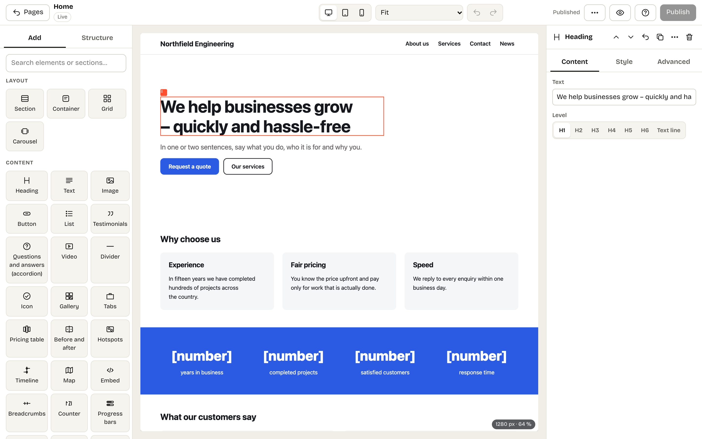

<p><picture><source media="(prefers-color-scheme: dark)" srcset="image/kaleta-logo-tmavy.svg"></picture></p>

# Kaleta

**Open-source CMS pro firemní weby – a malou kancelář za nimi.** Začnete webem, poptávky sbíráte, jakmile zákazníci
napíšou, a kancelář zapnete, až s nimi začne pracovat tým: zákazníci, obchody, nabídky, žádosti o místo a sdílené soubory
v téže administraci. Vizuální builder stránek s výstupem na úrovni ručně psaného HTML, AI asistent a napojení Clauda přes
MCP, import z WordPressu.
[English](README.md)



> Web projektu: [kaletacms.com](https://kaletacms.com) · návod: [kaletacms.com/cs/navod](https://kaletacms.com/cs/navod) · poslední verze: [GitHub Releases](https://github.com/phprs-cms/kaletacms/releases/latest) · co bude dál: [roadmap](docs/ROADMAP.md) · [historie vydání](docs/CHANGELOG.md) (anglicky) · [pravidla vydávání](docs/RELEASE-POLICY.md) (anglicky)

## Co umí

Kaleta je jedna instalace ve třech krocích. **Funkce** zapnou, co krok potřebuje, a **Uživatelé** nebo **Role** určí, kdo
kterou sekci otevře – nabídky, žádosti o místo a interní soubory jen ti, koho vybere správce.

### 1. Web

- **Builder stránek** – plátno je skutečná stránka webu. Prvky a hotové sekce přetáhnete na místo, styl nastavíte zvlášť
  pro počítač, tablet, mobil i najetí myší. Koncept se ukládá průběžně, na web jde až tlačítkem Publikovat; starší verze
  se dají obnovit.
- **Knihovna 40 hotových sekcí** (úvody, služby, ceník, reference, tým, galerie, kontakt s formulářem…) a **tři startovací
  weby** k instalaci. Texty podle jazyka stránky.
- **Design systém** – styly jedním klikem, barvy s kontrolou čitelnosti (WCAG), tmavý režim, písma, plynulé velikosti
  a mezery. Všechno jsou tokeny, takže změna barvy přebarví celý web.
- **Části webu** – záhlaví, patička a obálky detailu novinky, výpisu a stránky 404 v builderu, včetně variant pro
  vybrané stránky (landing page bez navigace).
- **Pop-up okna** – okna, vysouvací panely a lišty z builderu se spouštěči (čas, rolování, odchod, nečinnost, počet
  stránek), pravidly podle stránek, jazyka, období, zařízení a kampaně a počitadly zobrazení a konverzí bez cookies.
- **Komponenty** – znovupoužitelné bloky s vlastnostmi; úprava komponenty se projeví všude, kde je použitá.
- **Kolekce** – vlastní typy obsahu (reference, tým, produkty, pobočky…) s vlastními poli, výpis v builderu se
  značkami `{{pole}}`, filtry, řazením a stránkováním, stránky položek se šablonou z builderu.
- **AI** – asistent navrhne novou sekci podle popisu, přepíše text prvku, navrhne titulky, SEO popisy, korekturu i překlad
  (Claude, OpenAI, Google Gemini nebo Mistral). Claude navíc může web stavět přes **MCP**: HTML převede na stavbu,
  upraví části webu, kolekce i vzhled – vždy jako koncept ke schválení.
- **Novinky** (blog), weby asi ve čtyřiceti jazycích, administrace česky, anglicky, německy a španělsky, SEO a llms.txt, přesměrování,
  zálohy a podepsané aktualizace, **import z WordPressu** (i rovnou do builderu).

### 2. Web s poptávkami

- **Formuláře a poptávky** – poptávkový formulář bez CAPTCHA a cookies, poptávky v administraci, upozornění e-mailem,
  export CSV a automatické mazání osobních údajů.
- **Firma** – adresa, IČO, otevírací doba a mapa jednou v Nastavení; web je vypíše a vyhledávače dostanou strukturovaná
  data LocalBusiness.
- **Online rezervace** – služby, lidé a jejich pracovní doba; návštěvník si zarezervuje volný termín, služba může čekat
  na vaše potvrzení a zákazník dostane připomínku.
- **Newsletter** – přihlášení s potvrzením (double opt-in); rozešlete nejnovější novinky v e-mailu podle design systému
  (přes SMTP), nebo potvrzené odběratele pošlete do Brevo, MailerLite, Mailchimp, Ecomail, SmartEmailing či přes webhook.
- **Měření návštěvnosti bez cookies** – návštěvy, zařízení a které stránky a kampaně přivádějí poptávky.

### 3. Kancelář

- **Moje práce a tým** – co na koho čeká: úkoly, poptávky a záznamy, za které odpovídá, nabídky k dořešení. Oddělení,
  organizační struktura a nepřítomnosti se zástupcem, kterému chodí kopie upozornění.
- **Zákazníci a firmy** – jeden záznam na zákazníka napříč poptávkami, rezervacemi a odběrem newsletteru, s časovou osou
  a záznamy týmu o hovorech, schůzkách a poznámkách.
- **Obchody** – nástěnka od prvního kontaktu po vyhraný nebo prohraný obchod, s důvodem prohry a dalším krokem jako úkolem.
- **Nabídky a interní ceny** – ceník, který vidí jen váš tým, nabídka z poptávky na pár kliknutí, odeslaná e-mailem
  s PDF a soukromým odkazem, kde ji zákazník může přijmout nebo odmítnout.
- **Žádosti o místo** – přihlášky z kariérních stránek odděleně od poptávek, šifrované životopisy, nástěnka pozice,
  odpovědi ze šablon a zásoba uchazečů se souhlasem.
- **Interní soubory** – dokumenty týmu ve složkách s přístupem podle role nebo oddělení, verze a štítky, nikdy veřejně.
- **Konzole webů** – pro agentury: všechny weby na Kaletě, o které se staráte, na jedné obrazovce, s kontrolami,
  aktualizacemi po vlnách a měsíčními reporty.

Každá sekce kanceláře má v administraci krátkou kapitolu návodu (**Jak s tím pracovat** vedle nadpisu) a Claude s ní umí
pracovat přes MCP – připraví koncepty a bez vašeho souhlasu nic neodešle. Nic z toho se nedostane na veřejný web.

## Zásady

- **Bez technologického dluhu:** čisté PHP 8.3+, žádný framework, Composer ani build krok; žádné cizí pluginy.
- **Čistý výstup:** jeden prvek builderu = jedna HTML značka, CSS jen toho, co stránka používá, ve vrstvách kaskády
  (`@layer`); JavaScript jen tam, kde je opravdu potřeba. Hlídají to testy.
- **Web 2026:** fluidní typografie a mezery, container queries, barvy v OKLCH (`color-mix`), Popover API, přechody mezi stránkami.
- **AI jako rovnocenný uživatel:** co jde v editoru, jde i přes MCP – stejné schéma, validace i oprávnění.
- **Soukromí a přístupnost jako výchozí stav:** žádné cizí skripty ani písma, kontrola kontrastu barev.
- **Instalace přes FTP**, podepsané aktualizace.

## Instalace

1. Stáhněte balíček `kaleta-X.Y.Z.zip` z [Releases](https://github.com/phprs-cms/kaletacms/releases/latest) a nahrajte jeho obsah
   (i skryté soubory `.htaccess`) na hosting s PHP 8.3+ a MySQL 8 / MariaDB 10.6+.
   Na PHP 8.3 se zapnutým JIT ponechte výchozí `opcache.jit = tracing`: režim po funkcích (`1235`) má v 8.3 chybu, která shazuje
   stránky – Stav systému na ni upozorní.
2. Založte prázdnou databázi.
3. Otevřete `https://vas-web.cz/install.php`, vyplňte formulář a vyberte ukázkový web.

Další verze si web stáhne a nainstaluje sám (Nastavení → Zálohy a aktualizace); balíčky jsou podepsané vydavatelem.
Nginx nečte `.htaccess` – použijte ukázku `system/nginx.example.conf` (anglicky). Návod k používání je v [příručce](docs/prirucka.md).

## Vývoj

```bash
php -S localhost:8080 system/dev-router.php
```

Testy: `php tools/unit-tests.php` (jednotkové, bez databáze) a `tools/test.sh` (čistá instalace a průchod webem, administrací,
builderem i MCP; potřebuje MySQL; `WEB=remeslo tools/test.sh` otestuje jiný ukázkový web). Pravidla pro přispěvatele
jsou v [`CONTRIBUTING.md`](CONTRIBUTING.md), architektura v [`docs/ARCHITECTURE.md`](docs/ARCHITECTURE.md) (anglicky), pravidla pro AI
agenty v [`CLAUDE.md`](CLAUDE.md).

## Podpora

Kaleta je zdarma, bez reklam, placených verzí a licenčních klíčů. Pokud vám šetří čas, můžete její vývoj podpořit na
[Buy Me a Coffee](https://buymeacoffee.com/Kaletacms) – viz [proč je Kaleta zdarma](https://kaletacms.com/cs/proc-zdarma).

## Licence

GNU GPL verze 2 nebo novější. Text licence je v souboru [`LICENSE`](LICENSE).
