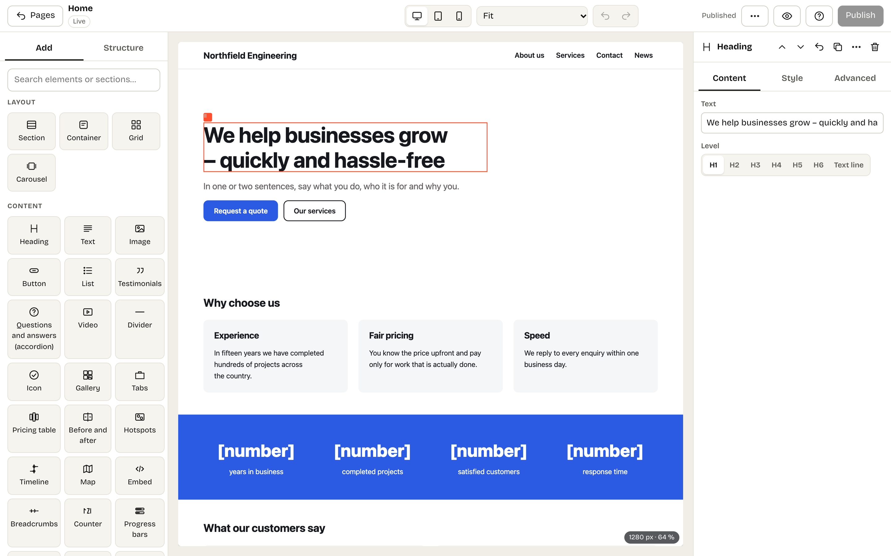
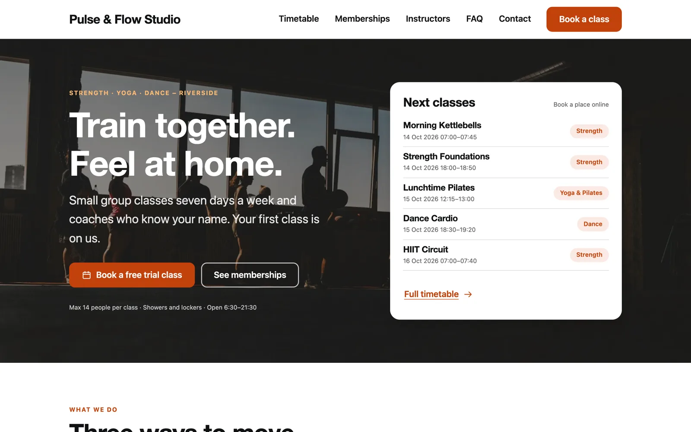
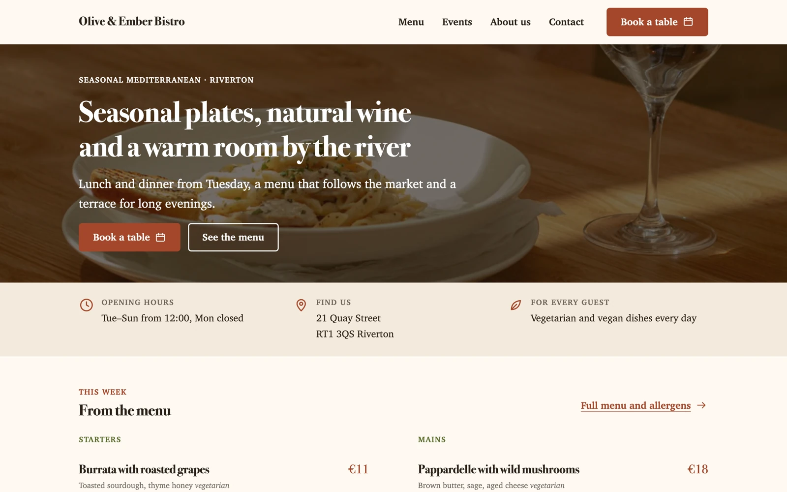
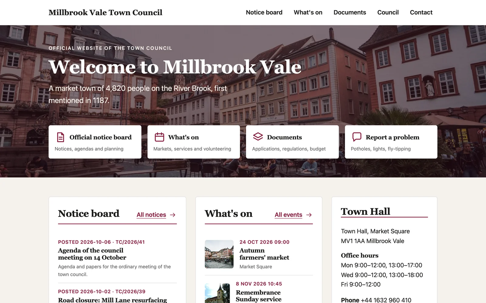

<p><picture><source media="(prefers-color-scheme: dark)" srcset="image/kaleta-logo-tmavy.svg"></picture></p>

# Kaleta

**An open-source CMS for business websites – and the small office behind them.** Start with a website, collect
enquiries when customers write, and switch on the office when your team works with them: customers, deals, quotes, job
applications and shared files, in the same administration. A visual page builder whose output reads like hand-written
HTML, an AI assistant, Claude over MCP, and a WordPress importer.
[Česky](README.cs.md)



> Project website: [kaletacms.com](https://kaletacms.com) · guide: [kaletacms.com/guide](https://kaletacms.com/guide) · latest version: [GitHub Releases](https://github.com/phprs-cms/kaletacms/releases/latest) · what comes next: [roadmap](docs/ROADMAP.md) · [changelog](docs/CHANGELOG.md) · [release policy](docs/RELEASE-POLICY.md)

## Features

Kaleta is one installation in three steps. **Features** switches on what a step needs, and **Users** or **Roles** decide
who opens each section – quotes, job applications and internal files only for the people an administrator chooses.

### 1. A website

- **Page builder** – the canvas is the real page. Drag elements and ready-made sections into place, style them separately
  for desktop, tablet, mobile and hover. Drafts save continuously and go live only when you publish; older versions can be restored.
- **Library of 40 ready-made sections** (heroes, services, pricing, testimonials, team, gallery, contact with a form…) and
  **three starter sites** at installation. Texts follow the page language.
- **Design system** – one-click styles, colours with a readability (WCAG) check, dark mode, fonts, fluid sizes and spacing –
  all tokens, so changing a colour restyles the whole site.
- **Site parts** – header, footer and wrappers for the news item, news list and 404 page in the builder, including
  variants for selected pages (a landing page without navigation).
- **Pop-ups** – windows, slide-in panels and bars built in the builder, with triggers (time, scrolling, exit intent,
  idle time, page count), rules by page, language, period, device and campaign, and cookie-free views and conversions.
- **Components** – reusable blocks with properties; editing a component updates it everywhere.
- **Collections** – custom content types (testimonials, team, products, branches…) with their own fields, listed in the
  builder with `{{field}}` tags, filters, sorting and pagination, and item pages with a builder template.
- **AI** – the assistant drafts a new section from a description, rewrites element text, suggests headlines, SEO
  descriptions, proofreading and translation (Claude, OpenAI, Google Gemini or Mistral). Claude can also build the site
  over **MCP**: it turns HTML into builder content and edits site parts, collections and the design – always as a draft to approve.
- **Industry blueprints** – 20 packages for a kind of business (a clinic, a restaurant, a driving school, a municipality…):
  the collections it needs, the facts to state, checks in the site audit and instructions for Claude.
- **News** (blog), sites in around forty languages, the admin in Czech, English, German and Spanish, SEO and llms.txt, redirects, backups and signed updates,
  **WordPress import** (straight into the builder, too).

### 2. A website with enquiries

- **Forms and enquiries** – an enquiry form without CAPTCHA or cookies, enquiries in the admin with a reply by e-mail,
  e-mail notifications, CSV export and automatic deletion of personal data.
- **Company details** – address, company ID, opening hours and map once in Settings; the site shows them and search
  engines get LocalBusiness structured data.
- **Online booking** – services, people and their hours; visitors book a free time, a service can wait for your
  confirmation, and customers get a reminder.
- **Newsletter** – double opt-in sign-up; send your latest news in an e-mail styled by the design system (through SMTP),
  or pass confirmed subscribers to Brevo, MailerLite, Mailchimp, Ecomail, SmartEmailing or any service via a webhook.
- **Analytics without cookies** – visits, devices, and which pages and campaigns bring enquiries.

### 3. The office

- **My work and the team** – what waits for each person: tasks, the enquiries and records they are responsible for,
  quotes to follow up. Departments, an org chart and absences with a deputy who gets a copy of the notifications.
- **Customers and companies** – one record per customer across enquiries, bookings and newsletter sign-ups, with a
  timeline and the team's log of calls, meetings and notes.
- **Deals** – a board from the first contact to won or lost, with the reason of a loss and the next step as a task.
- **Quotes and internal prices** – a price list only your team sees, quotes from an enquiry in a few clicks, sent by
  e-mail with a PDF and a private link where the customer can accept or decline.
- **Job applications** – applications from your job pages apart from enquiries, encrypted CVs, a board per position,
  replies from templates and a talent pool with consent.
- **Internal files** – the team's documents in folders with access by role or department, versions and tags, never public.
- **Fleet** – for agencies: every Kaleta site you look after on one screen, with checks, updates in rings and monthly reports.

Each office section has a short chapter in the administration (**How to use this** next to its heading), and Claude can
work with all of it over MCP – it prepares drafts and sends nothing without your yes. Nothing here ever reaches the public site.

### Examples

Fictional example sites built with a starter site, an industry blueprint and their own colours and fonts – sample
content and free stock photos ([all 18](docs/screenshots/examples), one on each page of [kaletacms.com/solutions](https://kaletacms.com/solutions)).

| | | |
|---|---|---|
|  |  |  |
| Fitness studio | Restaurant | Municipality |

## Principles

- **No technical debt:** plain PHP 8.3+, no framework, Composer or build step; no third-party plugins.
- **Clean output:** one builder element = one HTML tag, CSS only for what the page uses, in cascade layers (`@layer`);
  JavaScript only where it is really needed. Tests enforce it.
- **Web 2026:** fluid type and spacing, container queries, OKLCH colours (`color-mix`), the Popover API, view transitions.
- **AI as a first-class user:** whatever works in the editor works over MCP – same schema, validation and permissions.
- **Privacy and accessibility by default:** no third-party scripts or fonts, colour contrast checks.
- **FTP installation**, signed updates.

## Installation

1. Download `kaleta-X.Y.Z.zip` from [Releases](https://github.com/phprs-cms/kaletacms/releases/latest) and upload its contents
   (including the hidden `.htaccess` files) to hosting with PHP 8.3+ and MySQL 8 / MariaDB 10.6+.
   On PHP 8.3 with the JIT on, keep PHP's default `opcache.jit = tracing`: the per-function mode (`1235`) has a crash bug in 8.3
   that System status points out.
2. Create an empty database.
3. Open `https://your-site.com/install.php`, fill in the form and choose a starter site.

Later versions are downloaded and installed by the site itself (Settings → Backups and updates); packages are signed by the publisher.
Nginx does not read `.htaccess` – use the example in `system/nginx.example.conf`. The user guide is in [docs/guide.md](docs/guide.md).

### Locked out of the admin

- A lost password: **Forgotten your password?** on the sign-in page sends a link to the account's e-mail (it changes only the
  password – a second step the account has stays).
- A lost phone or passkey: a **backup code** after the password; or another administrator resets the account's second
  factor and passkeys in **Users**.
- The only administrator lost the passkey and has no backup codes: add `define('KALETA_PASSKEY_ONLY_OFF', true);` to
  `config.php` (see `config.sample.php`). Every "passkey only" rule is switched off and an administrator whose only second
  step is a passkey signs in with the password alone. The admin shows a warning on every page until the line is removed –
  register a passkey again in **My account**, then remove it.

## Development

```bash
php -S localhost:8080 system/dev-router.php
```

Tests: `php tools/unit-tests.php` (unit, no database) and `tools/test.sh` (clean install plus a walk through the site, admin,
builder and MCP; needs MySQL; `WEB=remeslo tools/test.sh` tests another starter site). `tools/test-lighthouse.sh` holds every
starter site to the output budget; `php tools/contracts.php` shows changes of the public contracts (MCP tools, design tokens,
builder elements); static analysis is PHPStan with `phpstan.neon.dist`. How to contribute is in
[`CONTRIBUTING.md`](CONTRIBUTING.md); the architecture is in
[`docs/ARCHITECTURE.md`](docs/ARCHITECTURE.md), the working rules for AI agents in [`CLAUDE.md`](CLAUDE.md) (Czech).

## Support

Kaleta is free, with no ads, paid tiers or licence keys. If it saves you time, you can support its development on
[Buy Me a Coffee](https://buymeacoffee.com/Kaletacms) – see [why Kaleta is free](https://kaletacms.com/why-free).

## Licence

GNU GPL version 2 or later. The licence text is in [`LICENSE`](LICENSE).
